<div align="center">



# Óptica Dr. Semeraro · Frontend

**Sistema de gestión clínica para ópticas**: expedientes, agenda, inventario,
ventas, órdenes de laboratorio y portal del paciente, en una sola SPA.

[](https://github.com/JAbarca74/Dr.-Semeraro-Opticians/actions/workflows/ci.yml)
[](https://github.com/JAbarca74/Dr.-Semeraro-Opticians/actions/workflows/codeql.yml)
[](./LICENSE)
[](./CONTRIBUTING.md)


[Características](#-características) ·
[Arquitectura](#-arquitectura) ·
[Inicio rápido](#-inicio-rápido) ·
[Solución de problemas](#-solución-de-problemas) ·
[Contribuir](#-contribuir) ·
[Seguridad](#-seguridad)

</div>

---

## ✨ Características

Proyecto real para la **Óptica Dr. Semeraro** (Pérez Zeledón, Costa Rica),
desarrollado como proyecto académico en la **Universidad Nacional (UNA)**.
El frontend está en este repositorio; la API (NestJS) vive en
[`optica-semeraro-api`](https://github.com/JAbarca74/optica-semeraro-api).

| Para quién | Qué puede hacer |
| --- | --- |
| 🌐 **Visitantes** | Catálogo público de aros, perfil del especialista, solicitud de cita por WhatsApp y **verificación pública de recetas** por código hash |
| 🧑‍⚕️ **Doctor** | Expedientes clínicos con refracción, agenda de cupos y órdenes de laboratorio |
| 🗂️ **Recepción** | Pacientes, agenda, existencias, caja y seguimiento de laboratorio |
| 🛡️ **Administración** | Bodega con kardex, ventas y anulaciones, métricas con exportación CSV/PDF, usuarios y auditoría |
| 👤 **Paciente** | Portal propio con sus expedientes y el estado de sus pedidos, con cuenta activada por invitación |

Además:

- 🌍 **Tres idiomas** (español, inglés e italiano) con catálogos **tipados**: un
  texto sin traducir no compila.
- 🔐 **Control de acceso por rol** en cada ruta, además del que aplica la API.
- 🎞️ Ilustraciones **SVG animadas** que respetan `prefers-reduced-motion`.
- 📱 Diseño adaptable, probado desde 375 px.
- ✅ **Cobertura del 100 %** de la lógica de `core/` y `shared/`, exigida en CI.

## 🏗️ Arquitectura



Los dos repositorios se despliegan por separado y solo se comunican por HTTP. El
frontend **no guarda ningún secreto**: solo conoce la URL de la API
(`VITE_API_URL`).

```
src/
├── main.tsx · App.tsx · router.tsx   # Entrada, providers y rutas
├── core/
│   ├── api/        # Instancia Axios + interceptores (Bearer / 401) y servicios
│   ├── auth/       # AuthContext, login, utilidades de token (JWT)
│   ├── guards/     # ProtectedRoute (sesión) y RoleRoute (RBAC)
│   ├── i18n/       # Catálogos tipados es · en · it y selector de idioma
│   └── models/     # Tipos del dominio (Rol, Usuario, Venta, Inventario…)
├── layouts/        # PublicLayout · AdminLayout · ReceptionLayout
├── features/       # public/ · auth/ · admin/ · recepcion/ (una página por ruta)
└── shared/         # Componentes reutilizables
```

## 🚀 Inicio rápido

### Requisitos

1. **Node.js 24**: <https://nodejs.org> (la misma versión mayor que usa CI).
2. **Docker Desktop instalado y abierto**: <https://www.docker.com/products/docker-desktop>.
   PostgreSQL corre en un contenedor; **no hace falta instalarlo**.
3. **Los dos repositorios en la misma carpeta**, uno al lado del otro:

```
mi-carpeta/
├── optica-semeraro-web/   ← este repo (aquí se ejecuta npm start)
└── optica-semeraro-api/
```

```bash
git clone https://github.com/JAbarca74/Dr.-Semeraro-Opticians optica-semeraro-web
git clone https://github.com/JAbarca74/optica-semeraro-api
```

### Un solo comando

```bash
cd optica-semeraro-web
npm start
```

**Eso es todo.** El script [`scripts/arrancar.mjs`](./scripts/arrancar.mjs) es
idempotente y se puede repetir sin miedo:

| Paso | Acción |
| --- | --- |
| 1 | Comprueba Node, Docker, que la API esté al lado y que los puertos 3000 y 5173 estén libres |
| 2 | Crea los `.env` que falten a partir de los `.env.example` (con un `JWT_SECRET` aleatorio) |
| 3 | Instala dependencias en ambos repos, solo si no están |
| 4 | Levanta PostgreSQL y Mailpit en Docker y espera a que acepten conexiones |
| 5 | Aplica migraciones y carga el seed (permisos, RBAC y cuentas de demostración) |
| 6 | Arranca API y frontend a la vez, con los registros de ambos en la misma terminal |

Al terminar:

- **Frontend** → <http://localhost:5173>
- **API** → <http://localhost:3000/api>
- **Buzón de correo de desarrollo (Mailpit)** → <http://localhost:8025>

`Ctrl+C` detiene ambos. La base de datos sigue levantada a propósito, para
conservar los datos; para pararla: `npm run db:down` en el repo de la API.

> [!TIP]
> **Si usas un agente de IA (Claude Code, Cursor, Copilot…), que ejecute
> `npm start` y nada más.** Sin instalar dependencias por separado, sin levantar
> Docker a mano y sin correr migraciones por su cuenta. Si algo falla, **el
> propio error dice qué hacer**.

> [!IMPORTANT]
> **La API tarda ~1 minuto en responder la primera vez.** Vite sirve el
> frontend en un segundo, pero Nest compila TypeScript antes de abrir el puerto.
> Mientras tanto verás `ERR_CONNECTION_REFUSED` en la consola del navegador:
> **no es un fallo**. Espera a la línea
> `Nest application successfully started` y recarga con `Ctrl`+`Shift`+`R`.
> La consola no se limpia sola al navegar, así que límpiala antes de dar un
> error por bueno.

Para saber si la API está viva sin adivinar:

```bash
curl -s -o /dev/null -w "%{http_code}\n" http://localhost:3000/api/catalogo
```

`200` = lista. `000` = todavía no escucha.

### Cuentas de demostración

Aparecen como botones de acceso directo en la pantalla de inicio de sesión. Las
crea el seed **solo en tu base local**:

| Correo | Contraseña | Rol | Entra en |
| --- | --- | --- | --- |
| `admin@optica.local` | `admin1234` | Administrador | `/admin` |
| `doctor@optica.local` | `doctor1234` | Doctor | `/admin` |
| `recepcion@optica.local` | `recepcion1234` | Recepción | `/recepcion` |
| `paciente@optica.local` | `paciente1234` | Paciente | `/portal` |

> [!WARNING]
> Son credenciales públicas de desarrollo. **Nunca ejecutes el seed contra una
> base de producción** ni reutilices estas contraseñas en un entorno desplegado.

Cada rol ve **un menú distinto**. Si escribes a mano una ruta que tu rol no
tiene, la aplicación te devuelve a tu panel: es el comportamiento correcto.

### Activación de cuentas de pacientes

El alta pública directa está cerrada: los pacientes entran **por invitación**.

1. Entra como Doctor o Recepción y registra una ficha con correo (en Recepción,
   desde la agenda: selecciona un cupo y «Nuevo paciente»).
2. Abre [Mailpit](http://localhost:8025) y sigue el enlace de activación. Es un
   buzón de desarrollo; no envía correos reales.
3. Define la contraseña e inicia sesión con ese correo.

El enlace vence en 24 horas y sirve una sola vez; reenviarlo invalida el
anterior. Si falta el correo o falla el envío, el estado de la invitación se
consulta y se reenvía desde la cita o desde la ficha del paciente. Para envíos
reales hace falta configurar un proveedor SMTP en la API.

### Arranque en dos terminales

Si prefieres ver los registros por separado:

```bash
# Terminal 1: base de datos + API
cd optica-semeraro-api
npm run db:setup         # Docker + migraciones + seed (idempotente)
npm run start:dev:local  # espera el "Nest application successfully started"
```

```bash
# Terminal 2: frontend
cd optica-semeraro-web
npm run dev
```

Solo el frontend, contra una API que ya corre en `http://localhost:3000/api`:

```bash
npm install
cp .env.example .env    # ajusta VITE_API_URL si hace falta
npm run dev
```

## 🩺 Solución de problemas

| Mensaje | Qué hacer |
| --- | --- |
| «Docker está instalado pero no se está ejecutando» | Abre Docker Desktop, espera a que arranque y repite el comando |
| «No encuentro el repositorio de la API» | Clona `optica-semeraro-api` **al lado** de este repo |
| «Puertos ocupados» | Tienes otra copia corriendo: ciérrala con `Ctrl+C` |
| «La API no respondió» | Mira las líneas marcadas con `api` más arriba: ahí está el error real |
| `ERR_CONNECTION_REFUSED` **al abrir la página** | La API aún compila. Espera el mensaje de arranque y recarga |
| `ERR_CONNECTION_REFUSED` **con la API ya arrancada** | Tu pestaña no está en el 5173. `npm run preview` (:4173) no puede iniciar sesión: el `CORS_ORIGIN` de la API apunta al 5173 |
| La API arranca y **muere** al conectar con la base | Estás usando `start:dev` (Supabase, que se pausa por inactividad) en vez de `start:dev:local` (Docker) |

Para empezar la base de cero (**borra todos los datos**):

```bash
cd ../optica-semeraro-api && npm run db:reset
```

## 🧰 Scripts

| Comando | Descripción |
| --- | --- |
| `npm start` | **Arranque completo**: base de datos, API y frontend |
| `npm run dev` | Solo el servidor de desarrollo (Vite) |
| `npm run build` | Comprobación de tipos y compilación de producción |
| `npm run preview` | Sirve la compilación de producción |
| `npm run lint` | ESLint sobre `ts`/`tsx` |
| `npm run format` | Formatea con Prettier |
| `npm test` | Pruebas (Vitest) |
| `npm run test:coverage` | Pruebas con el umbral de cobertura que exige CI |
| `npm run seguridad:secretos` | Escanea el repositorio en busca de secretos |

## 🤝 Contribuir

¡Las contribuciones son bienvenidas! Lee la [guía de contribución](./CONTRIBUTING.md)
y el [código de conducta](./CODE_OF_CONDUCT.md) antes de abrir un *pull request*.
Para errores e ideas, usa las plantillas de *issues*.

## 🔒 Seguridad

Este sistema maneja datos clínicos. **Si encuentras una vulnerabilidad, no
abras un *issue* público**: repórtala en privado como explica
[SECURITY.md](./SECURITY.md).

- Ningún secreto vive en el código; solo se versiona `.env.example`.
- Un escáner de secretos corre en el *pre-commit* y en CI.
- Cabeceras de seguridad (HSTS, `nosniff`, `frame-ancestors`, `Permissions-Policy`) en [`vercel.json`](./vercel.json).
- Análisis estático con CodeQL y actualizaciones con Dependabot.

## 📄 Licencia y créditos

Distribuido bajo la [licencia MIT](./LICENSE).

Desarrollado por el **Grupo 84 · Ingeniería de Sistemas I · Universidad Nacional
(UNA)**, Costa Rica, para la Óptica Dr. Semeraro.

<div align="center"><sub>Hecho con 👓 en Pérez Zeledón</sub></div>
